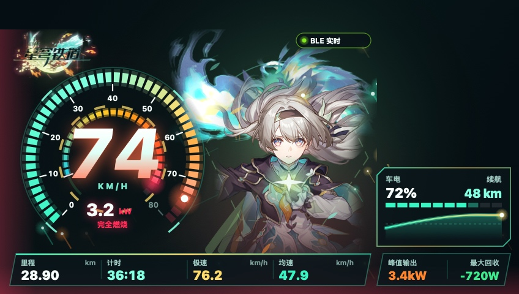
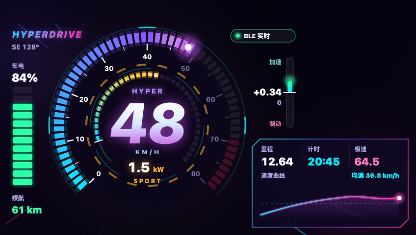
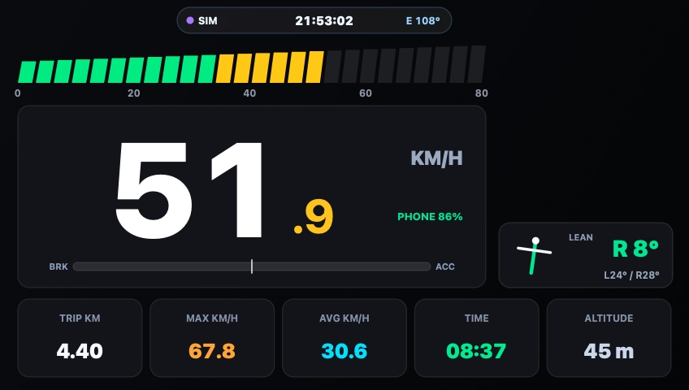

  
  <h1>NinebotDash</h1>
  
<strong>把九号 5 寸彩色仪表变成你的专属运动座舱（支持 iOS &amp; Android · 免密钥 GPS 投屏 &amp; 离线蓝牙实车遥测）</strong>

  

    
    
    
    
    
  

  

    <a href="https://github.com/zyfzsi/NinebotDash/releases/latest"><strong>立即下载最新安装包 (IPA / APK)</strong></a>
    ·
    <a href="#六套内置主题预览">六套主题预览</a>
    ·
    <a href="#新手-3-步上手教程零基础直接用">3 步新手教程</a>
    ·
    <a href="#进阶可选离线蓝牙遥测配置说明">蓝牙配置说明</a>
    ·
    <a href="#常见问题答疑">常见问题</a>
    ·
    <a href="https://github.com/zyfzsi/NinebotDash/issues">反馈问题</a>
  

---

## 一分钟了解 NinebotDash

**NinebotDash** 是一款专为 **九号 5 寸全彩 TFT 仪表** 打造的 **iPhone & Android** 自定义仪表盘投屏 App。**不用买外接盒子、不用 CarPlay**，手机连上车子自带的仪表热点（安卓还支持 Wi-Fi Direct 直连），就能把更帅、信息更全的动态仪表实时投到车机屏幕上。

### 两种用法，丰俭由人

- 🟢 **新手直接用（免凭证、免折腾）**：装好 App 就能直接上车投屏，自动用手机 GPS + 手机运动传感器测速，一样能看车速、加减速 G 值、本次极速、均速、里程和骑行时间。
- 🔵 **进阶实时车机数据（导入一次，离线使用）**：导入您自行准备的离线蓝牙凭证后，有效期内完全不用联网，手机直连车辆蓝牙读取 **精准实车车速、实时电机功率 / 动能回收（W / kW）、车辆剩余电量与续航**；蓝牙断开时会自动无缝切回 GPS，绝不黑屏。

### 核心亮点

- **iOS & Android 双端一致体验**：iOS 与 Android 共用同一套跨平台仪表渲染引擎，**6 套内置主题像素级一致**；支持手机锁屏放兜里稳定推流，非投屏后台智能休眠更省电。
- **超低延迟，几乎与原厂同步**：针对九号 5 寸仪表深度优化，默认 **`15 FPS` 超低延迟档位**（实车测试肉眼仅慢 1–2 帧，Wi-Fi 延迟 13–54 ms），支持等红灯自动降频帮车机清缓存、一拧电门立刻满帧；还能自动识别官方「九号出行」后台抢通道并弹窗提醒。
- **全套「肾上腺素」功率动效**：拧油门时功率条从青 → 琥珀 → 橙 → 红 → 炽粉逐级升温，带峰值停留回落与 `ECO / SPORT / BOOST / MAX` 负载分档，松油门动能回收一目了然。
- **专为九号 5 寸屏避让，零遮挡**：所有主题都精准避开九号顶部原生状态栏（时间、歌名、TCS、READY）和右上角原生信息卡片，不打架、不重叠。
- **纯只读更安全**：蓝牙连接严格只读车速、功率、电量、续航，**绝不发送任何修改车辆设置或控车指令**；离线凭证仅加密存在你自己手机本地，绝不上传任何服务器。

---

## 六套内置主题预览

支持在 App 里**骑行中一键实时切换**，全系适配 5 寸屏实车可读性，且内置 `60 / 80 / 100 / 120 km/h` 最高刻度自由调节：

### 1. 流萤 · 萨姆（FIREFLY）—— 崩坏：星穹铁道二次元 Live2D 座舱 ✨ NEW
> 左上角采用角色 PV「壳中萤火」片尾官方流萤专属星穹铁道 Logo；多层骨骼伪 Live2D 立绘呈现柔和呼吸、自然眨眼、风动长发、G 值惯性微倾与变身器星芒，拧油门时背后萨姆 IV 型完全燃烧等离子双翼展开觉醒，漫天萤火与光羽环绕不遮脸。

| 日常巡航（48 km/h） | 完全燃烧爆发（74 km/h） |
| :---: | :---: |
|  |  |

### 2. 超维引擎（HYPERDRIVE）—— 科幻反应堆 & 曲速星流
> 60 段霓虹速度环 + 彗星光头、随行驶里程转动的涡轮环、随车速拉长飞驰的曲速星流背景，全力输出时边缘呼吸脉冲。

| 日常巡航 | 红区全力爆发（MAX） |
| :---: | :---: |
|  |  |

### 3. 宝马运动（BMW Sport v2）—— 经典机车 TFT 风格
> 超大 150pt 斜体主车速（进入橙/红区自动变色发光）、折线爬坡速度推进带、双向功率/回收表与底部斜切信息胶囊。

| 日常巡航 | 高速红线（S+ / MAX） |
| :---: | :---: |
|  |  |

### 4. 运动霓虹 / 赛道遥测 / 极简高亮

| 运动霓虹（经典科技风） | 赛道遥测（MotoGP 转速条） |
| :---: | :---: |
|  |  |

  
<strong>极简高亮（白底黑字，正午大太阳下照样一眼看清）</strong>

  

---

## 新手 3 步上手教程（零基础直接用）

> **先说重点**：如果你只是想先体验自定义仪表投屏，**完全不需要配置蓝牙凭证**！照下面 3 步做，3 分钟就能在车上亮屏。

### 第 1 步：把 NinebotDash 安装到手机

打开 [最新版本下载页 (Releases)](https://github.com/zyfzsi/NinebotDash/releases/latest)：

#### 📱 iPhone 用户（iOS 16.0+）
下载 **`NinebotDash-*-unsigned.ipa`**，按你的设备情况任选其一安装：
- **情况 A：已装巨魔（TrollStore）—— 最省事**
  下载 `.ipa` 后，点分享 → 选择 **用 TrollStore 打开** → 点安装，永久有效不用续签。
- **情况 B：普通未越狱 iPhone —— 电脑签名安装**
  1. 电脑下载免费工具 **[Sideloadly](https://sideloadly.io/)**（Windows / Mac 均支持，或用 AltStore / SideStore / 爱思助手）。
  2. 数据线连上电脑，拖入 `.ipa`，填自己的 Apple ID 点 **Start** 等待装完。
  3. 首次打开若提示“未受信任”，去 iPhone **设置 → 通用 → VPN 与设备管理** 点 **信任** 即可。
  > 提示：普通免费 Apple ID 签名每 **7 天** 需连电脑续签一次；巨魔或个人/企业证书可长期使用。

#### 🤖 Android 用户（Android 8.0+）
下载 **`NinebotDash-Android-*-release.apk`**，在手机上直接点击安装即可（若系统提示未知来源，允许安装即可）。

### 第 2 步：首次打开 App，给齐权限

1. 打开 **NinebotDash**，按提示允许所需权限：
   - **定位权限**：建议设为 **「始终允许」**，这样锁屏把手机放兜里骑行不会中断。
   - **本地网络 / 附近设备（Wi-Fi & 蓝牙）**：**必须允许**，用于连九号仪表投屏以及读取车辆蓝牙。
   - **运动与健身 / 前台通知保活**：允许，用来提升 GPS 测速跟手度及后台保活。
2. 在 App 里你可以先开着 **「模拟骑行模式」** 在家预览全部 6 套主题的动画效果；**准备上车实测时，记得把「模拟骑行模式」关掉**。

### 第 3 步：上车投屏（🚨 照做绝不卡顿）

1. **开启车机投屏**：在九号车上（或先打开官方「九号出行」）启动 **5 寸仪表投屏**，然后手机连接九号仪表发出的热点（安卓也可在 App 内直接使用 **Wi-Fi Direct** 配对连接）。
2. **🚨 最关键一步：把官方「九号出行」从后台上划彻底关掉！**
   > **为什么一定要关？** 官方 App 留在后台会一直占着仪表投屏和蓝牙通道，导致画面延迟 1–3 秒甚至蓝牙频繁断线。只要上划划掉它，画面立刻丝滑如原厂！如果你忘了关，NinebotDash 主界面顶部也会弹出**橙色提示条**提醒你。
3. **开始推流**：切回 **NinebotDash**，选好你喜欢的主题，点击 **「开始投屏到九号 5 寸仪表」**。
4. **看到「仪表已回应 · 正在推流」就成功了！** 此时可以直接锁屏把手机放进口袋骑行（如果之前配置了蓝牙离线凭证，顺手点一下「连接」即可显示实时功率和车电）。

---

## 进阶（可选）：离线蓝牙遥测配置说明

> **先说明**：这一步完全可选！不配置蓝牙凭证也能正常使用 GPS + 手机传感器投屏。  
> 如果你想在仪表上显示更精准的 **实车车速、实时电机功率 / 动能回收、车辆电量与剩余续航**，则**需要自行获取并准备本车的离线蓝牙凭证**（**本仓库与 App 均不公开、不提供获取方法**）。

### 如何导入你已准备好的离线凭证

1. **填入 14 位车架号 `SN`**：站在通电的爱车旁 → 打开 **NinebotDash** → 点 **「蓝牙凭证配置」** → 点 **「扫描附近九号车辆自动填入 SN」** 选中你的车子即可（也可手动输入 14 位车架号）。
2. **粘贴你的离线凭证**：将你**自行准备的 32 位十六进制离线蓝牙凭证**（或完整授权 JSON）粘贴到输入框中，点击保存即可。
3. **连接使用**：主流电动二轮车保持默认车型预设即可（GT3 / G3 / ZT3 等滑板车可在车型预设中切换对应档位），上车后点击 **「连接车辆」** 即可离线读取实车遥测。

> **隐私与安全提示**：
> - 离线蓝牙凭证属于你的个人单车凭证，**请妥善保管，切勿发给他人或上传到网络**。
> - NinebotDash 仅把凭证加密保存在你自己的手机本地（iOS 钥匙串 / Android 加密存储），绝不上传任何服务器；且蓝牙协议层严格只读，绝不发送任何控车或修改车辆设置的指令。

---

## 常见问题答疑

<strong>1. 为什么车机上的画面比手机慢 1–3 秒？</strong>

99% 是因为官方 **「九号出行」还留在手机后台没有关掉**！请按下面检查：
1. 上划切换多任务，把 **「九号出行」彻底划掉**，然后回到 NinebotDash 点停止再重新开始投屏（如果主界面出现**橙色端口占用提醒条**，就说明官方 App 还在后台占着通道）。
2. 点右上角「设置」，确认推流帧率在推荐的 **`15 FPS（超低延迟推荐）`**（如果手调了 `25` 或 `30 FPS`，老款或信号一般时车机容易消化不过来导致积压延迟）。

<strong>2. 一直显示「等待九号仪表回应」，车机上没画面怎么办？</strong>

按顺序核对这 4 件事：
1. **Wi-Fi 连对了吗？** 必须连上九号仪表发出的热点（或安卓 Wi-Fi Direct 已连上仪表），不是家里的 Wi-Fi，也不是纯 4G/5G。
2. **车机进投屏页了吗？** 仪表屏幕需要处于投屏等待接收状态。
3. **本地网络 / 附近设备权限开了吗？** iPhone 请检查「设置 → 隐私与安全性 → 本地网络」；安卓请确认已允许附近 Wi-Fi 设备与定位权限并关闭对该 App 的后台电池限制。
4. **仪表 IP 对吗？** 默认是 `192.168.1.1`，极少数车型如有不同可在 App 设置里修改。

<strong>3. 「流萤 · 萨姆」「超维引擎」这种带动态特效的主题，等红灯时动画会卡住吗？</strong>

**不会！** 只有车子彻底停在 `0 km/h` 等红灯且没有拧油门时，App 才会自动降到低帧保活帮车机清缓存（流萤主题仍保持柔和呼吸与萤火慢漂）；只要你一拧电门、车在动、或者触发高功率爆发与红区预警，都会瞬间恢复满帧流畅运行。

<strong>4. 连蓝牙安全吗？会不会改车子参数、锁车或者影响质保？</strong>

**完全安全。** 蓝牙模块在代码层面严格限制为**只读**（仅做身份认证和读取车速、功率、电量、续航数据），绝不会发送任何写指令或控车指令；你的离线蓝牙凭证也只加密保存在你自己的手机本地，不会上传到任何服务器。

<strong>5. 蓝牙提示「离线蓝牙凭证已过期或与车辆不匹配」或偶尔断线重连怎么办？</strong>

- **提示过期/不匹配**：说明离线凭证已到期、在别处被重新签发，或者填错了 SN。请自行重新准备本车新的离线蓝牙凭证后在蓝牙配置页重新导入即可。
- **骑行中偶尔断连**：九号蓝牙不允许两个 App 同时连车，请确认已经把官方「九号出行」从后台划掉。

<strong>6. 遇到 Bug 或想提建议怎么反馈？</strong>

在 App 底部点 **「导出日志 (.txt)」**（日志中不含任何凭证或密钥信息，不会泄露隐私），然后到本仓库的 [Issues 页面](https://github.com/zyfzsi/NinebotDash/issues) 描述现象并贴上日志内容即可。

---

## 安全提醒与说明

- 本工具仅作为辅助骑行展示界面，**实际车速与行车安全请始终以车辆原厂显示与路面情况为准，骑行途中请勿低头操作手机**。
- 本仓库仅对外提供产品说明、效果展示与编译好的安装包（Releases），不包含源代码。详见 [LICENSE](LICENSE)。
