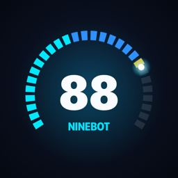
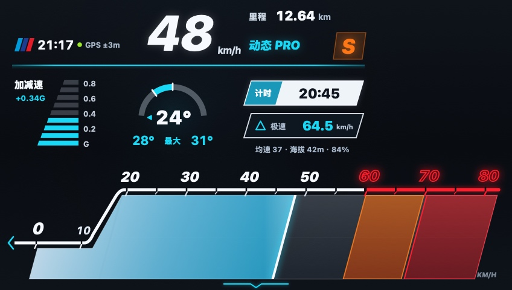
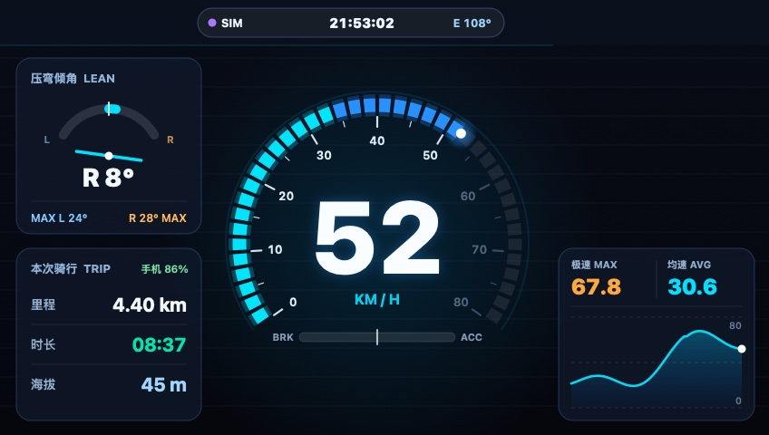
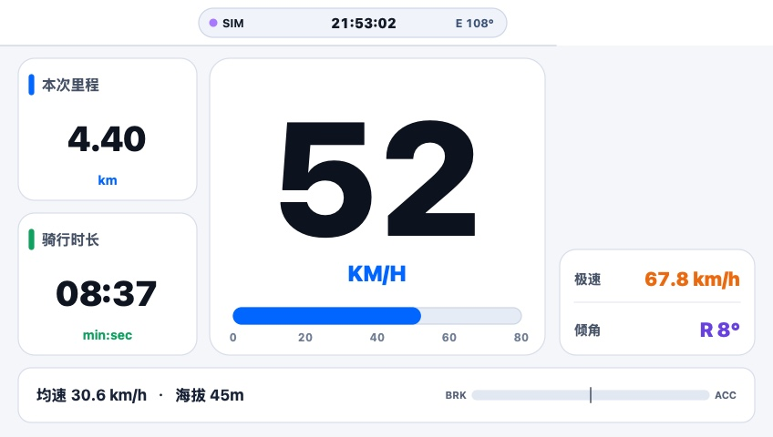

  
  <h1>NinebotDash</h1>
  
<strong>专为九号 5 寸全彩 TFT 仪表（848×480）打造的自定义 GPS 运动仪表投屏 App</strong>

  

    
    
    
  

  

    <a href="https://github.com/zyfzsi/NinebotDash/releases/latest"><strong>立即下载最新 IPA</strong></a>
    ·
    <a href="#四套内置主题预览">主题预览</a>
    ·
    <a href="#安装与上车使用">安装与使用</a>
    ·
    <a href="https://github.com/zyfzsi/NinebotDash/issues">问题反馈</a>
  

---

## 简介

**NinebotDash** 是一款面向 **九号 5 寸全彩 TFT 仪表** 的 iOS 自定义仪表盘投屏应用：

- **无需 CarPlay、无需外接盒子**：手机直连九号仪表热点即可将 `848×480 @ 30 FPS` 高清动态仪表画面实时投射到车机屏幕。
- **专屏定制，零遮挡避让**：全部主题均按九号 5 寸实机投屏界面精准测绘，完整避开左上状态图标、右上 `READY` 与右侧原生悬浮信息卡片。
- **低延迟测速 + 30 FPS 丝滑动画**：采用 50 Hz 6 轴惯导（免电机磁场干扰）融合 GNSS 延迟补偿算法，起步响应跟手、急刹迅速归零，配合 30 FPS 临界阻尼动画，速度数字与进度条顺滑扫动不瞬移。
- **锁屏后台保活**：支持静音混音保活（不打断音乐与语音导航），手机锁屏放兜里依然稳定推流不掉帧。
- **内置 HTTP 实时预览与日志导出**：支持局域网浏览器实时查看画面、热切主题与下载截图，并在 App 内提供一键导出 `.txt` 诊断日志方便排查反馈。

---

## 四套内置主题预览

支持在 iPhone App 或局域网预览网页中一键实时热切：

| 宝马运动（中文全宽版） | 宝马运动（高速红线压弯） |
| :---: | :---: |
|  |  |

| 运动霓虹 | 赛道遥测 |
| :---: | :---: |
|  |  |

  
<strong>极简高亮（正午强光直视优化）</strong>

  

---

## 核心功能一览

- **多维实时骑行遥测**：实时车速、本次极速、均速、骑行里程与计时、压弯实时倾角与左右历史极值、纵向加减速 G 值、海拔高度与指南针航向、手机电量与时间。
- **可调速度表满刻度**：设置页支持一键切换 `60 / 80 / 100 / 120 km/h` 满刻度，自动重排刻度与橙/红警示区。
- **可调 GPS 延迟补偿**：内置 `轻度 (0.8s)` / `标准 (1.4s · 推荐)` / `激进 (2.0s)` 三挡惯导补偿，按不同车型和路况自由微调手感；也可关闭融合切换纯直通 GPS。
- **倾角一键归零 & 防误触**：支持任意手机支架角度或揣兜姿态一键归零，自动过滤手持晃动误记录最大倾角。

---

## 安装与上车使用

### 1. 下载与安装 IPA

1. 前往本仓库 [Releases 页面](https://github.com/zyfzsi/NinebotDash/releases/latest) 下载最新的 **`NinebotDash-*-unsigned.ipa`**（最低要求 `iOS 16.0`，`arm64`）。
2. 使用你常用的 iOS 安装/签名工具安装到 iPhone：
   - **TrollStore（巨魔）**：直接导入安装，永久有效。
   - **AltStore / SideStore / Sideloadly / 个人开发者证书**：导入并签名安装。

### 2. 上车投屏步骤

1. 在九号车辆上打开 5 寸仪表的**投屏功能**，让 iPhone 在系统设置中连上九号仪表 Wi-Fi（默认仪表 IP 为 `192.168.1.1`）。
2. 打开 **NinebotDash**，首次使用请允许**定位（建议“始终”以支持锁屏）**、**运动与健身**、**本地网络**权限。
3. 关闭 **「模拟骑行模式」** 以切换为真实传感器测速。
4. 将手机放稳或固定到车把后，点击一次 **「倾角归零」**。
5. 选择喜欢的主题，点击 **「开始投屏到九号 5 寸仪表」**，状态变为 **「仪表已回应 · 正在推流」** 即可骑行。

---

## 常见问题

- **Q：投屏没有画面或一直显示“等待九号仪表回应”？**  
  请确认：① iPhone 已连上九号仪表热点（非普通家用 Wi-Fi）；② 仪表端已经进入投屏接收页面；③ 系统设置 → 隐私与安全性 → 本地网络 中已允许 NinebotDash；④ 若仪表 IP 不是默认 `192.168.1.1`，可在 App 右上角设置里修改。
- **Q：如何反馈 Bug 或测速手感问题？**  
  在 App 底部的「诊断日志与导出」中点击 **「导出日志 (.txt)」**，前往 [Issues](https://github.com/zyfzsi/NinebotDash/issues) 提交问题描述并附上日志片段（注意可自行删去不需要公开的信息）。
- **Q：安全提示**  
  本工具仅作为辅助骑行展示界面，实际车速与安全请始终以车辆原厂仪表与路面情况为准，骑行时请勿低头长时间操作手机。

---

## 说明与许可

本仓库仅对外提供产品说明、效果展示与编译发布包（Releases），不包含源代码。详见 [LICENSE](LICENSE)。
