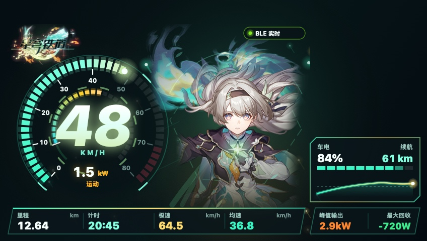
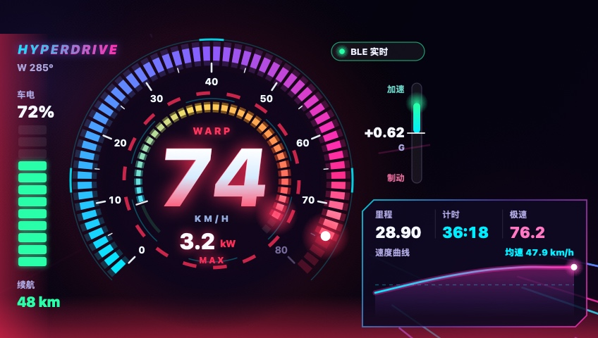
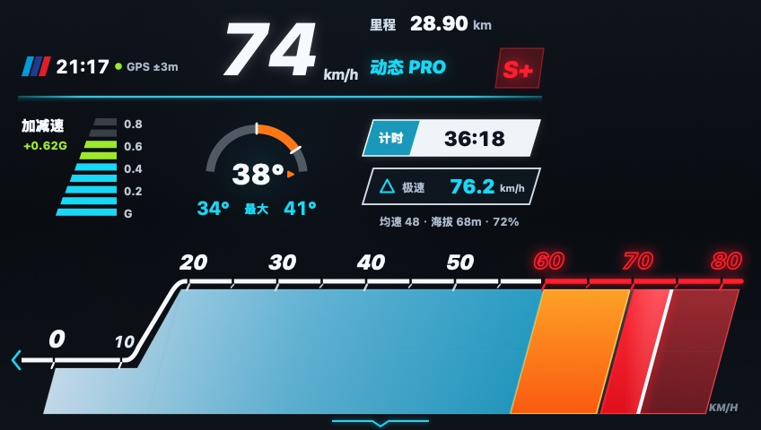

  
  <h1>NinebotDash</h1>
  
<strong>把九号全彩仪表变成你的专属运动座舱（支持 iOS &amp; Android · 免密钥 GPS 投屏 &amp; 离线蓝牙实车遥测）</strong>

  

    
    
    
    
    
  

  

    <a href="https://github.com/zyfzsi/NinebotDash/releases/latest"><strong>立即下载最新安装包 (IPA / APK)</strong></a>
    ·
    <a href="#六套内置主题预览">六套主题预览</a>
    ·
    <a href="#新手-3-步上手教程零基础直接用">3 步新手教程</a>
    ·
    <a href="#进阶可选离线蓝牙遥测与电量配置">蓝牙与电量配置</a>
    ·
    <a href="#常见问题答疑">常见问题</a>
    ·
    <a href="#致谢与参考项目">致谢</a>
    ·
    <a href="https://github.com/zyfzsi/NinebotDash/issues">反馈问题</a>
  

---

## 一分钟了解 NinebotDash

**NinebotDash** 是一款专为 **九号智能全彩 TFT 仪表** 打造的 **iPhone & Android** 自定义仪表盘投屏 App。**不用买外接盒子、不用 CarPlay**，手机连上车子自带的仪表热点（安卓还支持 Wi-Fi Direct 直连与智能核验），就能把更帅、信息更全的动态仪表实时投到车机屏幕上。

### 两种用法，丰俭由人

- 🟢 **新手直接用（免凭证、免折腾）**：装好 App 就能直接上车投屏，自动用手机 **GPS + 50 Hz 六轴惯导（航向对齐与延迟补偿）** 测速，一样能看车速、加减速 G 值、本次极速、均速、里程和骑行时间；如果装了小哈锂电，免蓝牙凭证也能直接显示实时电量。
- 🔵 **进阶实时车机数据（导入一次，离线使用）**：导入您自行准备的离线蓝牙凭证后，有效期内完全不用联网，手机直连车辆蓝牙读取 **精准实车车速、实时电机功率 / 动能回收（W / kW）、车辆电量 / 实时电压与剩余续航**；支持无感解锁 / 官方 App 占链后的系统已连蓝牙复用，蓝牙断开时自动无缝回退 GPS，绝不黑屏。

### 核心亮点

- **iOS & Android 双端像素级一致**：双端共用同一套跨平台仪表渲染引擎，**6 套内置主题呈现完全一致**；支持手机锁屏放兜里稳定推流（iOS 后台静音保活 + 网卡绑定 + 硬编同帧自愈；Android / 鸿蒙多级 H.264 编码策略与前台服务保活），非投屏后台智能休眠更省电。
- **多尺寸仪表与自动联动**：主力稳定支持 **5 寸全彩屏（`848×480` H.264/UDP）**，并提供实验性 **4.3 寸（`480×272` JPEG/UDP）** 与 **7 寸（`1024×600` H.264/KCP）** 投屏与画面自适应缩放；支持仪表 Wi-Fi 网段自动识别、一键自动连蓝牙并投屏、可选实验性 **BLE 直启开屏（`0x23:0x71` 白名单）** 以及车辆热开关机自动重投。
- **超低延迟与高清防发糊**：默认 **`15 FPS` 超低延迟档位**（实车 Wi-Fi RTT `13–54 ms`），内置 `5013` 心跳队列积压自动排空、动态关键帧画质保护与等红灯低帧排空；支持端口占用检测、防官方投屏抢屏保活以及 Android Wi-Fi Direct 蓝牙 MAC 同号段自动核验。
- **全场景车电方案**：统一支持 **原厂车机电量**、无库仑计车型 **48V / 60V / 72V 实时电压 + 容量智能估算**，以及 **小哈锂电 BLE 广播直读**（支持锁屏后台刷新/保持与未绑定防邻车串台）。
- **全套「肾上腺素」功率动效与零遮挡避让**：拧油门时功率条从青 → 琥珀 → 橙 → 红 → 炽粉逐级升温，带峰值停留与 `ECO / SPORT / BOOST / MAX` 负载分档；所有主题严格避让九号顶部原生状态栏与右上角悬浮卡片。
- **默认严格只读，隐私安全**：蓝牙模块默认仅读取车速、功率、电压、电量与续航，绝不发送任何改车或控车指令（实验性 `0x23:0x71` 投屏开屏开关默认关闭，需首次连车成功后由用户手动开启）；离线凭证仅加密存在本地，绝不上传任何服务器。

---

## 六套内置主题预览

支持在 App 里**骑行中一键实时切换**，全系适配 5 寸屏实车可读性，且内置 `60 / 80 / 100 / 120 km/h` 最高刻度自由调节：

### 1. 流萤 · 萨姆（FIREFLY）—— 崩坏：星穹铁道二次元 Live2D 座舱 ✨
> 左上角采用角色 PV「壳中萤火」片尾官方流萤专属星穹铁道 Logo；多层骨骼伪 Live2D 立绘呈现柔和呼吸、自然眨眼、风动长发、G 值惯性微倾与变身器星芒，拧油门时背后萨姆 IV 型完全燃烧等离子双翼展开觉醒，漫天萤火与光羽环绕不遮脸。

| 日常巡航（48 km/h） | 完全燃烧爆发（74 km/h） |
| :---: | :---: |
|  |  |

### 2. 超维引擎（HYPERDRIVE）—— 科幻反应堆 & 曲速星流
> 60 段霓虹速度环 + 彗星光头、随行驶里程转动的涡轮环、随车速拉长飞驰的曲速星流背景，全力输出时边缘呼吸脉冲。

| 日常巡航 | 红区全力爆发（MAX） |
| :---: | :---: |
|  |  |

### 3. 宝马运动（BMW Sport v2）—— 经典机车 TFT 风格
> 超大 150pt 斜体主车速（进入橙/红区自动变色发光）、折线爬坡速度推进带、双向功率/回收表与底部斜切信息胶囊。

| 日常巡航 | 高速红线（S+ / MAX） |
| :---: | :---: |
|  |  |

### 4. 运动霓虹 / 赛道遥测 / 极简高亮

| 运动霓虹（经典科技风） | 赛道遥测（MotoGP 转速条） |
| :---: | :---: |
|  |  |

  
<strong>极简高亮（白底黑字，正午大太阳下照样一眼看清）</strong>

  

---

## 新手 3 步上手教程（零基础直接用）

> **先说重点**：如果你只是想先体验自定义仪表投屏，**完全不需要配置蓝牙凭证**！照下面 3 步做，3 分钟就能在车上亮屏。

### 第 1 步：把 NinebotDash 安装到手机

打开 [最新版本下载页 (Releases)](https://github.com/zyfzsi/NinebotDash/releases/latest)：

#### 📱 iPhone 用户（iOS 16.0+）
下载 **`NinebotDash-*-unsigned.ipa`**，按你的设备情况任选其一安装：
- **情况 A：已装巨魔（TrollStore）—— 最省事**
  下载 `.ipa` 后，点分享 → 选择 **用 TrollStore 打开** → 点安装，永久有效不用续签。
- **情况 B：普通未越狱 iPhone —— 电脑签名安装**
  1. 电脑下载免费工具 **[Sideloadly](https://sideloadly.io/)**（Windows / Mac 均支持，或用 AltStore / SideStore / 爱思助手）。
  2. 数据线连上电脑，拖入 `.ipa`，填自己的 Apple ID 点 **Start** 等待装完。
  3. 首次打开若提示“未受信任”，去 iPhone **设置 → 通用 → VPN 与设备管理** 点 **信任** 即可。
  > 提示：普通免费 Apple ID 签名每 **7 天** 需连电脑续签一次；巨魔或个人/企业证书可长期使用。

#### 🤖 Android / 鸿蒙用户（Android 8.0+）
下载 **`NinebotDash-Android-*-release.apk`**，在手机上直接点击安装即可（若系统提示未知来源，允许安装即可；正式签名支持同包名直接覆盖升级）。

### 第 2 步：首次打开 App，给齐权限

1. 打开 **NinebotDash**，按提示允许所需权限：
   - **定位权限**：建议设为 **「始终允许」**，这样锁屏把手机放兜里骑行不会中断。
   - **本地网络 / 附近设备（Wi-Fi & 蓝牙）**：**必须允许**，用于连九号仪表投屏以及读取车辆蓝牙 / 小哈电量广播。
   - **运动与健身 / 前台通知保活**：允许，用来提升 GPS+IMU 测速跟手度及后台保活。
2. 在 App 里你可以先开着 **「模拟骑行模式」** 在家预览全部 6 套主题的动画效果；**准备上车实测时，记得把「模拟骑行模式」关掉**。

### 第 3 步：上车投屏（🚨 照做绝不卡顿）

1. **开启车机投屏**：在九号车上（或先打开官方「九号出行」）启动仪表投屏，然后手机连接九号仪表发出的热点（安卓也可在 App 内直接使用 **Wi-Fi Direct** 配对连接，支持蓝牙 MAC 同号段自动识别仪表）。
2. **🚨 最关键一步：把官方「九号出行」从后台上划彻底关掉！**
   > **为什么一定要关？** 官方 App 留在后台会一直占着仪表投屏和蓝牙通道，导致画面延迟 1–3 秒甚至蓝牙频繁断线。只要上划划掉它，画面立刻丝滑如原厂！如果你忘了关，NinebotDash 主界面顶部也会弹出**橙色提示条**提醒你（并支持一键抢回独占端口）。
3. **开始推流**：切回 **NinebotDash**，确认仪表尺寸（默认 5 寸，可在设置页切换 4.3 寸 / 7 寸）与喜欢的主题，点击 **「开始投屏」**。
4. **看到「仪表已回应 · 正在推流」就成功了！** 此时可以直接锁屏把手机放进口袋骑行；如果已配置蓝牙离线凭证，开播时会自动同步连车显示实时功率与车电。

---

## 进阶（可选）：离线蓝牙遥测与电量配置

> **先说明**：这一步完全可选！不配置蓝牙凭证也能正常使用 GPS+IMU 投屏与小哈锂电广播。  
> 如果你想在仪表上显示更精准的 **实车车速、实时电机功率 / 动能回收、车辆电量 / 电压与剩余续航**，则**需要自行获取并准备本车的离线蓝牙凭证**（**本仓库与 App 均不公开、不提供获取方法**）。

### 1. 导入你已准备好的离线凭证

1. **填入 14 位车架号 `SN`**：站在通电的爱车旁 → 打开 **NinebotDash** → 点 **「蓝牙凭证配置」** → 点 **「扫描附近九号车辆自动填入 SN」** 选中你的车子即可（也可手动输入 14 位车架号；即使开启无感解锁导致车辆停止广播，App 也会自动检索系统已连蓝牙设备）。
2. **粘贴你的离线凭证**：将你**自行准备的 32 位十六进制离线蓝牙凭证**（或完整授权 JSON）粘贴到输入框中，点击保存即可。
3. **连接与进阶联动**：主流电动二轮车保持默认车型预设即可（GT3 / G3 / ZT3 等滑板车可在车型预设中切换对应档位），首次成功连车后自动记住本车设备免扫描直连，并可按需在设置中开启「检测到仪表 Wi-Fi 自动连蓝牙并投屏」及实验性「BLE 直启开屏（`0x23:0x71`）」。

### 2. 车电显示与小哈锂电配置

- **原厂带库仑计车型**：连上车辆蓝牙后自动显示原厂精准电量与续航。
- **改装锂电 / 无库仑计车型（仪表显示 0%）**：在 App **「电量设置」** 中选择电池电压平台（自动 48V/60V/72V）、电池体系（三元锂 / 磷酸铁锂 / 铅酸）与容量（Ah），即可基于实车电压自动估算电量并同步显示电压。
- **小哈锂电用户**：在 **「电量设置」** 中打开 **小哈锂电广播读取**，支持直接绑定自家电池防红灯串台，也支持未绑定自动择优与锁屏保持。

> **隐私与安全提示**：
> - 离线蓝牙凭证属于你的个人单车凭证，**请妥善保管，切勿发给他人或上传到网络**。
> - NinebotDash 仅把凭证加密保存在你自己的手机本地（iOS 钥匙串 / Android 加密存储），绝不上传任何服务器；且蓝牙默认严格只读，绝不发送任何修改车辆参数或控车指令。

---

## 常见问题答疑

<strong>1. 为什么车机上的画面比手机慢 1–3 秒？</strong>

99% 是因为官方 **「九号出行」还留在手机后台没有关掉**！请按下面检查：
1. 上划切换多任务，把 **「九号出行」彻底划掉**，然后回到 NinebotDash 点**抢回端口**或重启投屏（如果主界面出现**橙色端口占用提醒条**，就说明官方 App 还在后台占着通道）。
2. 点右上角「设置」，确认推流帧率在推荐的 **`15 FPS（超低延迟推荐）`**（手调过高的帧率在信号一般时容易造成车机解码积压）。

<strong>2. 一直显示「等待九号仪表回应」，车机上没画面怎么办？</strong>

按顺序核对这 4 件事：
1. **Wi-Fi 连对了吗？** 必须连上九号仪表发出的热点（或安卓 Wi-Fi Direct 已连上仪表），不是家里的 Wi-Fi，也不是纯 4G/5G。
2. **车机进投屏页了吗？** 仪表屏幕需要处于投屏等待接收状态（若已连车机蓝牙且开启了实验性 BLE 开屏开关，可由 App 自动唤起）。
3. **本地网络 / 附近设备权限开了吗？** iPhone 请检查「设置 → 隐私与安全性 → 本地网络」；安卓/鸿蒙请确认已允许附近 Wi-Fi 设备与定位权限并关闭对该 App 的后台电池限制。
4. **仪表型号与 IP 对吗？** 5 寸默认 `192.168.1.1`（Wi-Fi Direct 常见 `192.168.49.1`），4.3 寸默认 `192.168.169.1`，可在 App 设置中切换型号或手动修改 IP。

<strong>3. 「流萤 · 萨姆」「超维引擎」这种带动态特效的主题，等红灯时动画会卡住吗？</strong>

**不会！** 只有车子彻底停在 `0 km/h` 等红灯且没有拧油门时，App 才会自动降到低帧保活帮车机清缓存（流萤主题仍保持柔和呼吸与萤火慢漂）；只要你一拧电门、车在动、或者触发高功率爆发与红区预警，都会瞬间恢复满帧流畅运行。

<strong>4. 连蓝牙安全吗？会不会改车子参数、锁车或者影响质保？</strong>

**完全安全。** 蓝牙模块默认严格限制为**只读**（仅做身份认证和读取车速、功率、电压、电量、续航与开关机状态），绝不发送任何修改车辆设置或控车指令；唯一的白名单指令是默认关闭的实验性投屏开屏通知（`0x23:0x71`），且同样不涉及任何车辆动力/安全参数。离线蓝牙凭证仅加密保存在本机，绝不上传。

<strong>5. 蓝牙提示「离线蓝牙凭证已过期或与车辆不匹配」或无感解锁导致扫不到车怎么办？</strong>

- **提示过期/不匹配**：说明离线凭证已到期、在别处被重新签发，或者填错了 14 位 SN。请核对 SN 并自行重新准备本车新的离线蓝牙凭证后重新导入。
- **开启无感解锁后扫不到广播**：最新版已支持自动检索系统已连蓝牙设备直接复用链路，无需关闭无感解锁；若官方「九号出行」仍在后台占链，建议先划掉官方 App 再连。

<strong>6. 遇到 Bug 或想提建议怎么反馈？</strong>

在 App 底部点 **「导出日志 (.txt)」**（日志中不含任何凭证或密钥信息，不会泄露隐私），然后到本仓库的 [Issues 页面](https://github.com/zyfzsi/NinebotDash/issues) 描述现象并贴上日志内容即可。

---

## 致谢与参考项目

NinebotDash 的诞生离不开九号开源社区前辈们的探索与分享，开发过程中我们参考并借鉴了以下优秀开源项目的协议分析、架构经验或规范设计，在此一并致谢：

- **[xmz28/CarWithin](https://github.com/xmz28/CarWithin)**：致谢其在九号多尺寸仪表投屏协议（5 寸 H.264/UDP、4.3 寸 JPEG/UDP、7 寸 H.264/KCP）、UDP `5012/5013` 封包、默认网段与 BLE `0x23:0x71` 投屏开屏模式方面的开源探索与重要参考。
- **[xmz28/ninebot_pro](https://github.com/xmz28/ninebot_pro)**：致谢其在 Android 九号仪表 Wi-Fi Direct (P2P) 投屏连接、心跳节拍与重连防抖方面的实践参考。
- **[NinebotEnhance](https://github.com/lzl20110/NinebotEnhance)**：致谢其在 Android 高版本蓝牙（API 26–35）兼容适配、绘制节流与九号投屏交互思路上的启发与参考。
- **[skywind3000/kcp](https://github.com/skywind3000/kcp)**：致谢优秀的低延迟可靠传输协议 KCP 规范，本项目 7 寸仪表通道参考其线协议实现了零依赖的纯 Swift / 纯 Kotlin 兼容客户端。
- **所有参与实车路测、抓包与日志反馈的九号车友**：感谢大家在 5 寸 / 4.3 寸 / 7 寸实车、iOS / Android / 鸿蒙真机与小哈锂电上的持续实测反馈。

---

## 安全提醒与说明

- 本工具仅作为辅助骑行展示界面，**实际车速与行车安全请始终以车辆原厂显示与路面情况为准，骑行途中请勿低头操作手机**。
- 本仓库仅对外提供产品说明、效果展示与编译好的安装包（Releases），不包含源代码。详见 [LICENSE](LICENSE)。
